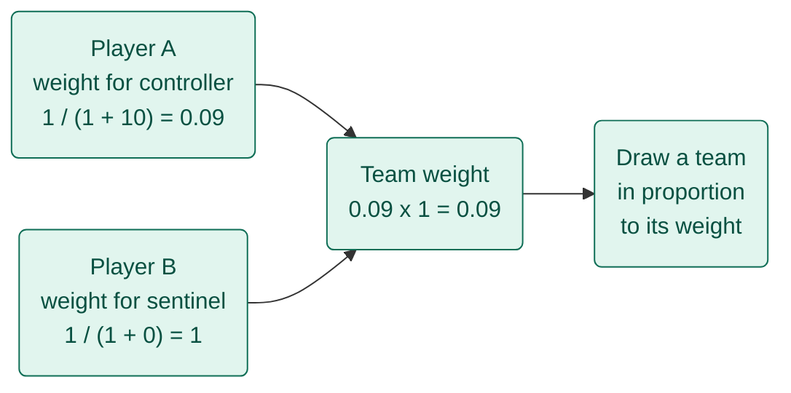
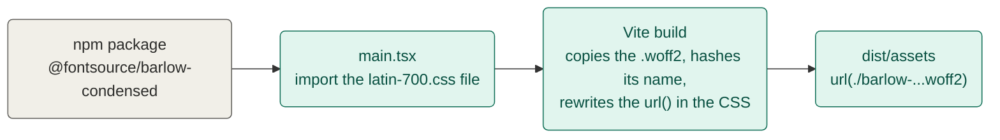
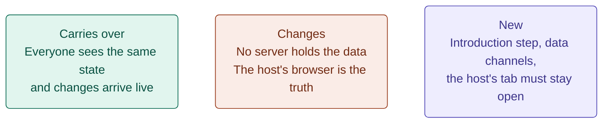
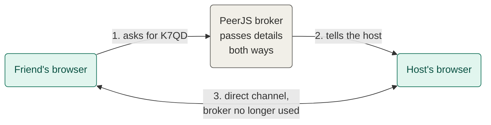
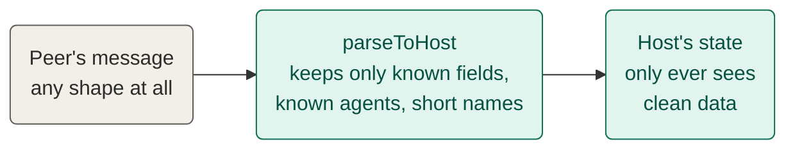

# LEARNINGS.md

Things learned while building this project, in small entries.

## A team's chance is the product of each player's weights
*23 October 2026 · Randomiser*

**How one team's chance is worked out**


*Teal = runs in the browser*

- **The trick**: give each player a weight for a role, multiply them for the whole team, then draw a team in proportion to that number
- **Old habit → new**: weigh and pick one player at a time → weigh every possible team together
- **Gotcha**: only teams that meet the role minimums count, so the weights have to be summed over those teams only, which is what `ways()` does

```ts
const weight = (recentCount: number) => 1 / (1 + recentCount);
```

## Importing a font's CSS makes Vite ship the font files
*23 October 2026 · Vite*

**What happens to a font from import to the hosted page**


*Teal = this project's build, grey = outside package*

- **The trick**: import the font package's CSS in `main.tsx`, and Vite treats every `url()` inside it as a file to bundle
- **Old habit → new**: put files in `public/` and write the path by hand (as with the agent icons) → import the file and let the build work out the path
- **Why it matters here**: with `base: './'` the rewritten URL is relative, so the font still loads from `/lab/<id>/` on the portfolio (D14)
- **Gotcha**: import only the weights and subset you use (`latin-500.css`, not `500.css`), or the build copies every language's font file

```ts
import '@fontsource/barlow-condensed/latin-700.css'
```

## WebRTC
*24 October 2026 · Foundation*

**Meteor pub/sub → a WebRTC party (sibling)**


*Teal = carries over, coral = works differently, purple = new*

- **What it is**: a way for two browsers to send data straight to each other, with no server carrying it
- **Purpose**: lets friends on their own phones send bans to the host, with no backend to run
- **How it's used**: the host listens on a short code, friends connect to it, and a library (PeerJS) hides the setup
- **Pros / cons**: [+] nothing to host and the data stays between the phones. [-] the host's tab has to stay open, some networks block it, and a free broker still makes the first introduction
- **Compared to Meteor pub/sub**: the "everyone sees changes live" idea carries over, but there is no server in the middle, so the host's browser plays the part of both the server and the database. Reconnecting is ours to write, where DDP does it for you
- **Why it fits this project**: the page is static on the portfolio (D14), and a party is a few friends for one evening, so a host's tab that holds the state is enough (D20)

## Two browsers need an introduction before they can talk directly
*24 October 2026 · WebRTC*

**Who is involved before and after the connection**


*Teal = runs in a browser, grey = external*

- **The trick**: the host registers a name on the broker, and the friend asks the broker to connect them to that name. The broker passes the connection details across once, then the two talk directly
- **Old habit → new**: connect to a server's address → connect to a peer's name, through someone who introduces you
- **Gotcha**: "no server" is only true for the data. If the free broker is down, new joins fail, though a party that is already running carries on

```ts
const peer = new Peer(`vtr-party-${code}`); // the host
const conn = peer.connect(`vtr-party-${code}`); // a friend
```

## Anything from a peer is untrusted, so check it like saved data
*24 October 2026 · WebRTC*

**Where a message is checked before it is used**


*Teal = runs in the host's browser, grey = outside*

- **The trick**: every message goes through `parseToHost` and comes out either clean or as `null`, the same way `parseRoster` treats saved data
- **Old habit → new**: a Meteor method checks its arguments on the server → the host's browser is the server, so it has to do that check itself
- **Gotcha**: spreading a whole message onto a player copies fields like `type` too. Copy the lists by name instead, which a test now covers

```ts
const message = parseToHost(raw); // null if anything is off
if (message) onMessage(conn.peer, message);
```
