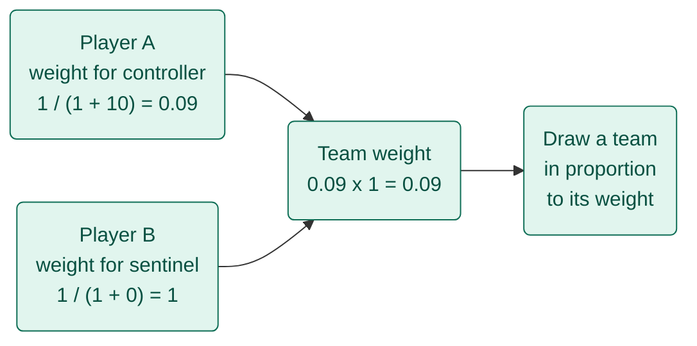

# LEARNINGS.md

Things learned while building this project, in small entries.

## A team's chance is the product of each player's weights
*23 October 2026 · Randomiser*

**How one team's chance is worked out**


*Teal = runs in the browser*

- **The trick**: give each player a weight for a role, multiply them for the whole team, then draw a team in proportion to that number
- **Old habit → new**: weigh and pick one player at a time → weigh every possible team together
- **Gotcha**: only teams that meet the role minimums count, so the weights have to be summed over those teams only, which is what `ways()` does

```ts
const weight = (recentCount: number) => 1 / (1 + recentCount);
```
