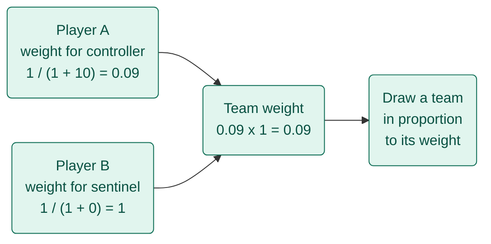
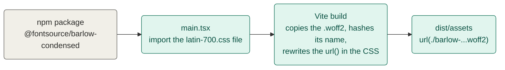

# LEARNINGS.md

Things learned while building this project, in small entries.

## A team's chance is the product of each player's weights
*23 October 2026 · Randomiser*

**How one team's chance is worked out**


*Teal = runs in the browser*

- **The trick**: give each player a weight for a role, multiply them for the whole team, then draw a team in proportion to that number
- **Old habit → new**: weigh and pick one player at a time → weigh every possible team together
- **Gotcha**: only teams that meet the role minimums count, so the weights have to be summed over those teams only, which is what `ways()` does

```ts
const weight = (recentCount: number) => 1 / (1 + recentCount);
```

## Importing a font's CSS makes Vite ship the font files
*23 October 2026 · Vite*

**What happens to a font from import to the hosted page**


*Teal = this project's build, grey = outside package*

- **The trick**: import the font package's CSS in `main.tsx`, and Vite treats every `url()` inside it as a file to bundle
- **Old habit → new**: put files in `public/` and write the path by hand (as with the agent icons) → import the file and let the build work out the path
- **Why it matters here**: with `base: './'` the rewritten URL is relative, so the font still loads from `/lab/<id>/` on the portfolio (D14)
- **Gotcha**: import only the weights and subset you use (`latin-500.css`, not `500.css`), or the build copies every language's font file

```ts
import '@fontsource/barlow-condensed/latin-700.css'
```
